[Azure ML MLOps 문서 사이트](https://daeungo1.github.io/azure-llm-mlops/)

## 1. MLOps에서 Azure ML을 활용하는 이유

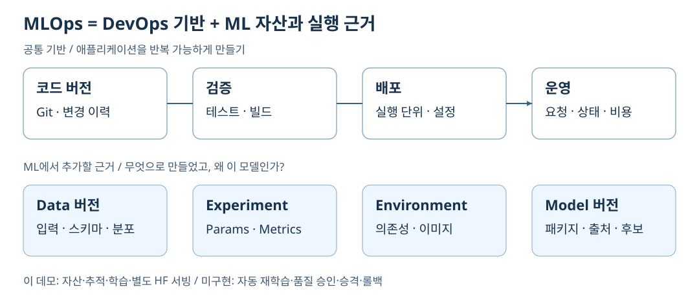

[SVG 원본 크게 보기](docs/images/mlops-overview.svg)

MLOps는 모델을 한 번 학습하는 작업을 넘어, 어떤 데이터·코드·환경으로 만들었는지
기록하고 평가한 모델을 서비스하며 운영 결과를 다음 개선에 연결하는 활동입니다.
DevOps의 코드 버전·테스트·배포에 데이터 버전, 실험 지표, 모델 패키지와 예측 품질 관리를 더합니다.

Azure Machine Learning은 이 과정의 자산과 실행 이력을 Workspace에서 관리합니다.
이 데모는 Azure ML Studio의 데이터, 학습, 실험, 모델,
실행 환경과 Endpoint가 맡는 역할을 다룹니다.

| 구분      | 이번 데모에서 확인할 흐름                                                        |
|-----------|---------------------------------------------------------------------------------|
| 학습 경로 | 합성 고객 이탈 데이터 → CPU 학습 → MLflow 실험 비교 → 학습 모델 등록              |
| 서빙 경로 | 별도의 Hugging Face 사전학습 MiniLM → 모델 등록·CPU 배포 → 인증·추론·오류 응답 확인 |

> [!IMPORTANT]
> 데모 Workspace는 `mlw-ktmlops-secure`이며 기본 리전은 Korea Central입니다.
> 학습한 고객 이탈 예측 모델과 서빙하는 HF 모델은 서로 다릅니다.
> HF 모델의 추가 학습이나 동일 학습 모델의 자동 배포를 구현한 구성은 아닙니다.
> 실제 실행 이력과 미검증 항목은 [배포 검증 결과](docs/deployment-status.md)에 구분했습니다.

공개 데모에는 합성 데이터만 사용합니다.
실제 고객 데이터, 고객 내부 설계 원문, 발표 자료, 자격 증명은 공개 대상에 포함하지 않습니다.
문서 사이트도 1~11번과 같은 본문과 SVG를 사용합니다.

## 2. 전체 아키텍처: Workspace를 중심으로 역할 나누기

<a id="아키텍처"></a>

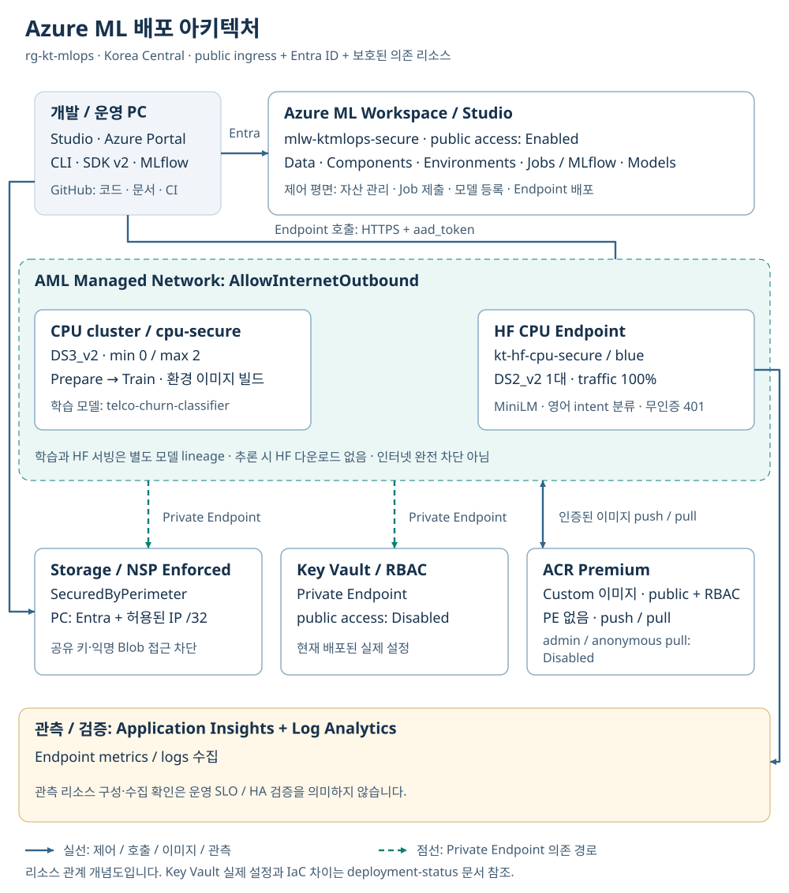

[아키텍처 SVG 원본 크게 보기](docs/images/azure-architecture.svg)

Workspace는 자산과 실행 이력을 연결하고, Compute는 학습 연산을 수행합니다.
Storage는 데이터·모델 파일을, ACR은 실행 환경 이미지를 보관합니다.
Managed Online Endpoint는 추론 요청을 처리하고,
Application Insights와 Log Analytics는 요청 및 로그를 살펴보는 데 사용합니다.

실선은 제어·호출·이미지·관측 연결이고 녹색 점선은 Private Endpoint 의존 경로입니다.
이 그림은 리소스와 연결의 개념도이며 실제 subnet 배치도는 아닙니다.
Storage는 NSP로 보호하고 AML의 Storage/Key Vault 의존 경로는 Private Endpoint를 사용합니다.
Studio와 Endpoint의 진입점, 인증된 ACR 이미지 경로는 public입니다.
public 접근과 익명 접근은 다릅니다.

확인 위치: Studio의 Workspace·Compute·Endpoints와 Azure Portal의 연결 리소스.
보안 경계와 운영 PC 접근 조건은 10번 항목에서 설명합니다.

### 2.1 리소스별 역할과 비용 경계

| 리소스 | MLOps에서의 역할 | 데모에서 확인할 것 | 비용·격리 단위 |
|---|---|---|---|
| Resource Group | 팀 자원·권한·비용 조회의 관리 범위 | 팀별 리소스 목록과 Cost analysis | 팀별 RG 3개, 공통 RG 별도 |
| Azure ML Workspace | 데이터·실험·모델·Job의 관리 공간 | 팀별 Studio와 실행 이력 | 팀별 전용 Workspace |
| Azure ML Registry | 여러 Workspace가 참조하는 ML 자산 카탈로그 | 동일 Model·Environment·Component 버전의 공유 | 공통 Registry 및 관리형 backing RG |
| Storage Account / Datastore | 실제 데이터·모델·Job 파일 저장과 연결 | 자기 팀 데이터 읽기와 다른 팀 접근 거부 | 팀별 전용 Storage |
| ACR | 컨테이너 실행 환경 이미지 저장 | Environment 이미지·태그·digest | 팀 전용 ACR, Registry backing ACR은 공통 |
| AML Compute cluster | 학습·검증 Job과 환경 이미지 빌드 | CPU 노드의 생성·종료와 Job 실행 | 팀 클러스터 최소 0 / 최대 1대 |
| Key Vault | Workspace 의존 비밀 정보 보관 | RBAC와 private 접근 경로 | 팀별 전용 Vault |
| Managed Network / VNet·Private Endpoint | AML에서 보호된 의존 리소스로 접근 | 기존 데모는 Managed Network, 새 팀은 전용 VNet·Private Endpoint | 팀별 VNet·NAT·DNS·연결 비용 |
| NSP | Storage의 public 네트워크 접근 경계 | Enforced 규칙과 운영자 IP 허용 | 팀별 Storage 경계, 데이터 RBAC 별도 |
| Managed Identity / RBAC | 자격 증명 없이 실행 주체별 권한 제한 | Compute identity의 자기 Storage 권한 | 리소스 범위별 권한, 태그와 구분 |
| Managed Online Endpoint / Deployment | 인증된 실시간 추론 API와 모델 실행 | HF 요청·응답·오류·배포 상태 | 기존 검증 Workspace의 상시 CPU 서빙 |
| Application Insights / Log Analytics | 요청 관측·로그 수집과 조회 | 호출 흔적·컨테이너 로그·보존 설정 | 팀별 수집·보존 비용 |
| Event Grid system topic / 기본 알림 | Azure 서비스가 생성하는 이벤트·관측 의존 기능 | 실제 구독·연결 여부 | 이름만 보고 불필요하다고 삭제하지 않음 |

Azure ML Registry와 ACR은 서로 다른 리소스입니다.
Registry는 모델·환경·Component 버전의 공유와 검색을 담당하고,
ACR은 컨테이너 이미지를 저장합니다. Registry도 자체 backing Storage와 ACR을 생성합니다.

### 2.2 팀별 RG와 공용 Registry

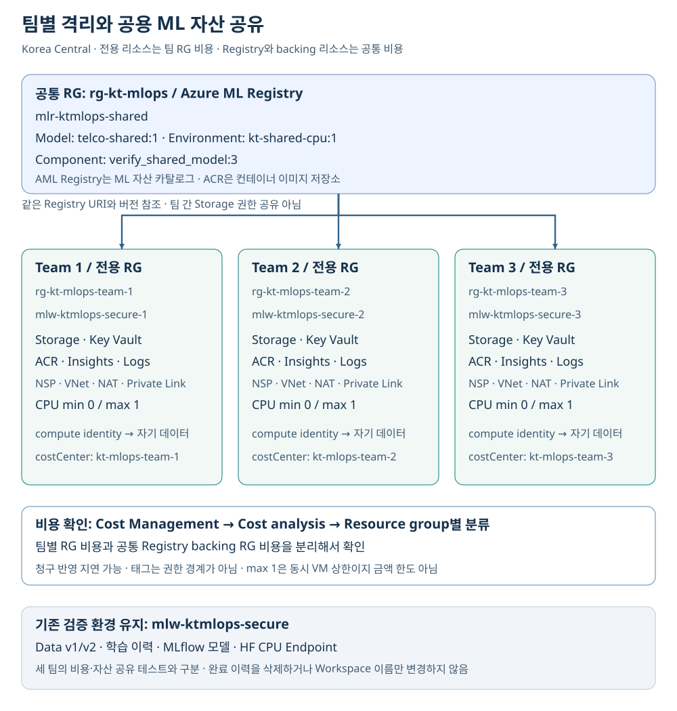

[팀별 격리·Registry 공유 SVG 크게 보기](docs/images/multi-team-architecture.svg)

| 구분 | Resource Group | Workspace / Registry | 비용 분류 |
|---|---|---|---|
| Team 1 | `rg-kt-mlops-team-1` | `mlw-ktmlops-secure-1` | `kt-mlops-team-1` |
| Team 2 | `rg-kt-mlops-team-2` | `mlw-ktmlops-secure-2` | `kt-mlops-team-2` |
| Team 3 | `rg-kt-mlops-team-3` | `mlw-ktmlops-secure-3` | `kt-mlops-team-3` |
| 공통 자산 | `rg-kt-mlops` 및 Registry 관리형 RG | `mlr-ktmlops-shared` | 공통 비용, 팀별 직접 비용과 구분 |
| 기존 검증 이력·서빙 | `rg-kt-mlops` | `mlw-ktmlops-secure` | 기존 교육 환경 비용 |

약 10개 팀으로 확장할 때의 구조를 3개 팀으로 축소해 보여줍니다.
Workspace 이름만 나누는 것이 아니라 Storage·Key Vault·ACR·로그와 Compute까지 RG별로 분리합니다.
공용 자산을 사용해도 다른 팀의 Storage 읽기 권한까지 공유하지는 않습니다.
팀의 Compute identity에는 자기 Storage 권한과 공용 Registry 읽기 권한만 부여합니다.
구독 Owner인 운영 계정의 접근 권한은 팀 실행 identity의 권한과 구분해야 합니다.

Cost Management의 Cost analysis에서 Resource group으로 묶어 팀 직접 비용을 확인합니다.
Registry가 자동 생성하는 관리형 RG의 Storage·ACR 비용은 별도 공통 비용입니다.
이 비용이 팀 RG로 자동 배분되는 것은 아닙니다.
`team`·`costCenter` 태그는 비용 식별을 돕지만 권한 경계나 지출 차단 장치는 아닙니다.
신규 사용량은 청구 반영 지연이 있어, 조회 결과가 없더라도 비용이 0이라고 단정하지 않습니다.

배포·공유 자산 소비·격리 테스트의 실제 결과는
[다중 팀 검증 기록](docs/deployment-status.md#다중-팀-rg와-공용-registry)을 기준으로 설명합니다.
팀 기본 인프라, 전용 VNet·Private Endpoint, private CPU Compute와
Registry 자산 등록을 완료했고, 세 팀의 실제 소비 Pipeline도 모두 Completed입니다.
동일 churn 모델 v1·환경 v1·검증 Component v3로 예측 `[1, 0, 1]`,
자기 Storage 읽기 200, 순환 상대 팀 읽기 403(`AuthorizationPermissionMismatch`)을 확인했습니다.
검사는 Team 1→2, 2→3, 3→1의 세 방향이며 전체 여섯 방향이나 팀 사용자 격리 검증은 아닙니다.
Registry 관리형 RG의 deny를 변경하거나 구독 범위 권한을 부여하지 않습니다.
기존 검증 Workspace는 완료된 학습과 HF 추론 이력을 보존하기 위해 유지하며,
실패한 초기 Workspace `mlw-ktmlops`와 Endpoint·Compute는 삭제 완료했습니다.
공유 Storage·ACR·Key Vault는 보존했고 기존 HF Endpoint의 정상 응답도 재확인했습니다.

## 3. Data와 Datastore: 데이터 위치와 버전을 구분하기

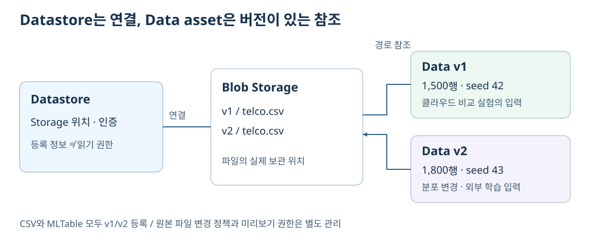

[SVG 원본 크게 보기](docs/images/data-asset-versions.svg)

Datastore는 Storage에 연결하는 방법을 관리하고,
Data asset은 학습에 사용할 데이터의 이름·버전·경로를 관리합니다.
등록만으로 원본 파일이 자동으로 불변화되는 것은 아니므로,
원본 경로와 파일 변경 정책도 함께 관리해야 합니다.

데모의 `telco-churn`과 `telco-churn-table`에는 각각 v1/v2가 있습니다.
v1은 1,500행, v2는 1,800행이며 데이터 분포도 다릅니다.
MLTable은 표 데이터를 읽는 정의를 제공하므로 파일 경로뿐 아니라 열과 데이터 형태를 설명할 수 있습니다.

확인 위치: Studio의 Data에서 버전·경로·MLTable 미리보기를,
Datastores에서 Storage 연결 정보를 확인합니다.
등록 정보 조회와 실제 데이터 읽기 권한은 별개이며,
미리보기에는 로그인 사용자 권한과 Storage 네트워크 접근이 모두 필요합니다.

## 4. Jobs와 Pipeline: 재현 가능한 학습의 조건 남기기

<a id="mlops-pipeline"></a>

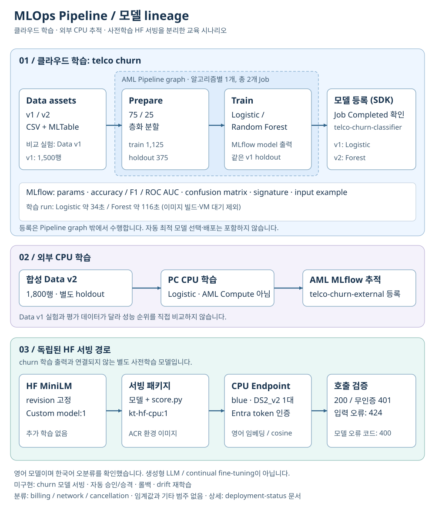

[Pipeline SVG 원본 크게 보기](docs/images/mlops-pipeline.svg)

학습 결과를 다시 설명하려면 모델 파일뿐 아니라 입력 데이터, 코드,
파라미터, 실행 환경과 출력의 관계가 필요합니다.
Azure ML Job은 실행 이력을 남기고, Pipeline과 Component는 데이터 준비와 학습 단계를 나누어 재사용합니다.

데모는 합성 데이터 v1을 1,125행 학습 / 375행 평가로 나누고,
Logistic Regression과 작은 Random Forest를 CPU에서 학습합니다.
AML Pipeline graph는 Prepare → Train이며,
모델 등록은 두 Job이 완료된 뒤 SDK에서 수행합니다.
서빙까지 연결된 단일 Pipeline graph는 아닙니다.

확인 위치: Jobs의 Pipeline graph에서 Inputs/Outputs, 코드 snapshot,
Environment, Compute와 실행 상태를 따라갑니다.
Components에서는 준비·학습 단계의 등록 버전을 확인합니다.

## 5. MLflow: 실험을 기록하고 같은 조건에서 비교하기

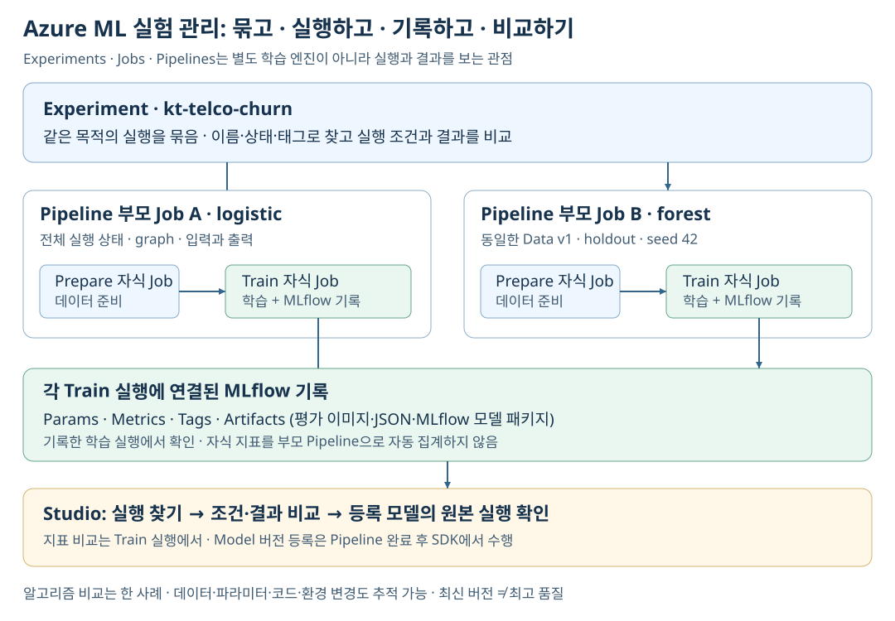

[SVG 원본 크게 보기](docs/images/mlflow-experiment-comparison.svg)

실험 추적의 목적은 지표 하나를 저장하는 것이 아니라,
어떤 조건이 결과를 만들었는지 비교할 수 있게 하는 것입니다.
MLflow로 파라미터, accuracy·F1·ROC AUC, confusion matrix와 모델 패키지를 기록합니다.

데모에서는 같은 데이터 v1과 동일한 holdout을 사용하는 두 학습 결과를 비교합니다.
데이터나 평가 조건이 다른 실험의 숫자를 곧바로 성능 순위로 해석하지 않습니다.
버전이 최신이라는 이유만으로 더 좋은 모델이라고 판단하지도 않습니다.

확인 위치: Jobs의 실험 `kt-telco-churn`에서 두 실행의 Metrics를 비교하고,
Outputs + logs에서 평가 파일과 MLflow 모델을 확인합니다.

## 6. Models: 파일 보관을 넘어 배포 후보 관리하기

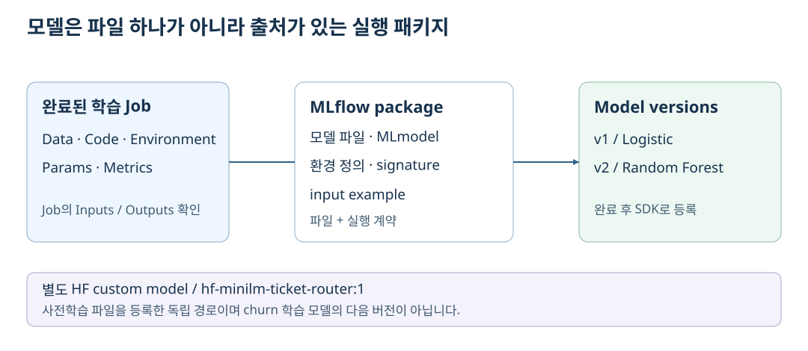

[SVG 원본 크게 보기](docs/images/model-package-lineage.svg)

모델 등록은 실행 결과에 이름과 버전을 부여하고,
원본 학습 Job 및 평가 근거를 따라갈 수 있게 하는 단계입니다.
데이터·환경·모델 버전을 함께 관리해야 변경 전후의 차이를 설명할 수 있습니다.

`telco-churn-classifier`의 v1은 Logistic Regression, v2는 Random Forest입니다.
MLflow 패키지에는 모델뿐 아니라 환경 정의, 입출력 signature와 input example이 포함됩니다.
별도 HF 모델 `hf-minilm-ticket-router:1`은 사전학습 파일을 담은 custom model로 등록했습니다.
두 종류의 패키징과 모델 출처를 구분합니다.

확인 위치: Models의 버전·파일·원본 Job 연결을 확인합니다.
운영에서는 여기에 품질 기준과 배포 승인을 더해야 하며,
이번 데모에는 자동 최적 모델 선택·승격·롤백을 구현하지 않았습니다.

## 7. Environments와 ACR: 모델이 실행되는 환경도 버전 관리하기

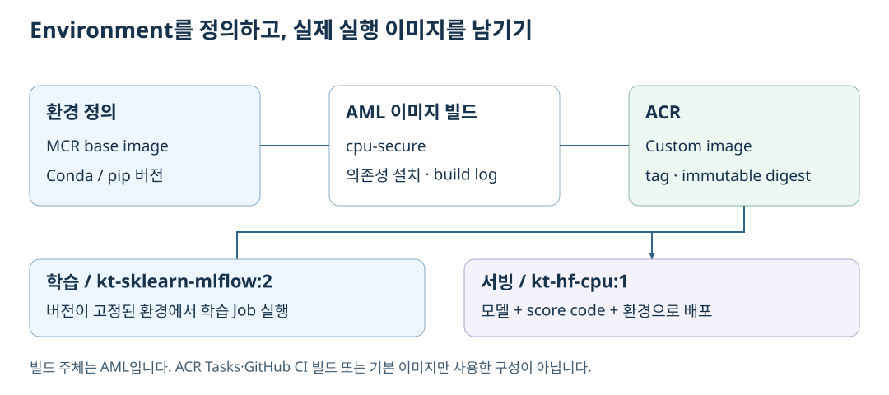

[SVG 원본 크게 보기](docs/images/environment-acr-build.svg)

같은 모델 파일이라도 라이브러리와 런타임이 바뀌면 동작이 달라질 수 있습니다.
Azure ML Environment는 실행 의존성을 정의하고,
ACR의 컨테이너 이미지는 해당 환경을 학습과 서빙에서 사용하는 단위가 됩니다.

데모는 학습용 `kt-sklearn-mlflow:2`와 서빙용 `kt-hf-cpu:1`을 사용합니다.
AML이 기본 이미지에 의존성을 설치한 Custom 이미지를 실제 빌드해 연결된 ACR에 저장했습니다.
이미지 빌드 성공과 그 이미지에서 학습·추론이 성공한 사실은 따로 확인합니다.
이 빌드는 GitHub CI나 ACR Tasks가 아니라 AML이 관리합니다.

확인 위치: Studio의 Environments에서 버전·의존성과 build log를,
Azure Portal의 ACR Repositories에서 이미지 태그와 digest를 확인합니다.
[빌드 Job과 이미지 검증 근거](docs/deployment-status.md#acr-custom-이미지-빌드-검증)를 함께 참고하세요.

## 8. Managed Online Endpoint: 모델을 인증된 API로 제공하기

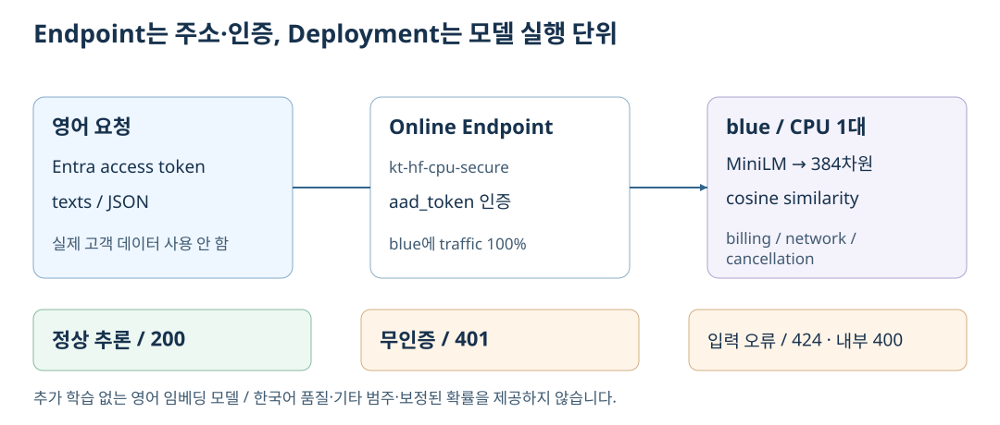

[SVG 원본 크게 보기](docs/images/endpoint-request-flow.svg)

Endpoint는 호출 주소를 제공하고 Deployment는 모델·실행 환경·인스턴스를 묶습니다.
이를 구분하면 모델 파일 관리와 실제 서비스 구성을 나누어 설명할 수 있습니다.
이번 데모는 `kt-hf-cpu-secure` Endpoint의 `blue` Deployment에 트래픽 100%를 연결했습니다.

사용 모델은 Hugging Face의
[`sentence-transformers/all-MiniLM-L6-v2`](https://huggingface.co/sentence-transformers/all-MiniLM-L6-v2)입니다.
약 22.7M 파라미터의 영어 문장 임베딩 모델로 문장을 384차원 벡터로 바꿉니다.
사전학습 모델을 추가 학습하지 않고, 대표 문장과의 cosine similarity로
상담 문장을 `billing`, `network`, `cancellation` 중 하나로 분류합니다.
고정 revision의 파일을 등록해 사용하므로 추론 시 HF 다운로드가 필요하지 않습니다.

확인 위치: Endpoints의 Test에서 영어 요청을,
Consume에서 호출 주소와 Entra 인증 방식을,
Logs/Monitoring에서 컨테이너 로그와 요청 지표를 확인합니다.
기존 호출 검증에서 정상 요청은 HTTP 200, 무인증은 401,
잘못된 입력은 외부 424와 내부 모델 오류 400을 확인했습니다.

> [!WARNING]
> 이 모델은 생성형 LLM이나 한국어 품질 검증 모델이 아닙니다.
> cosine similarity는 보정된 확률이 아니며, 임계값과 "기타" 범주도 없습니다.
> 한국어 3문장 호출에서는 모두 `cancellation`으로 분류되어 2건이 오분류되었습니다.
> 실제 고객 업무 판단에 사용하지 않습니다.

## 9. 외부 학습 연계: 연산 위치와 MLOps 관리 위치 분리하기

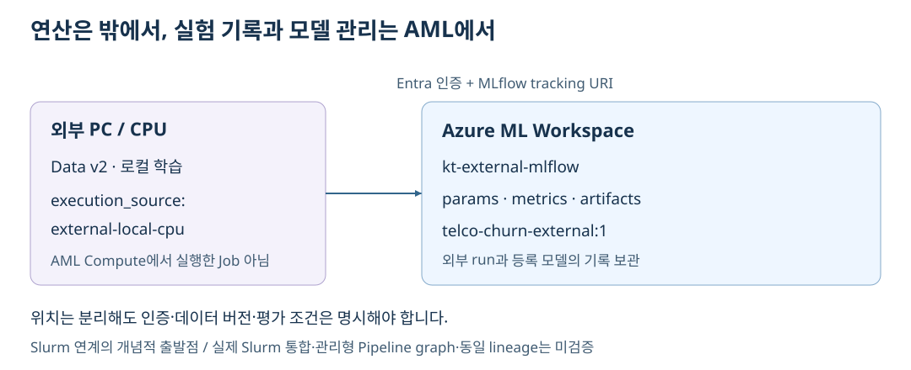

[SVG 원본 크게 보기](docs/images/external-training-tracking.svg)

학습을 모두 Azure ML Compute로 옮겨야만 MLflow를 활용할 수 있는 것은 아닙니다.
외부 연산 환경에서 학습하더라도 AML의 tracking URI와 인증을 구성해
실험과 모델을 Workspace에서 관리하는 패턴을 사용할 수 있습니다.

데모는 PC의 CPU에서 데이터 v2로 학습하고,
`kt-external-mlflow` 실험에 지표와 모델을 기록합니다.
연산은 PC에서 수행하므로 AML 관리형 Compute Job과 구분합니다.
데이터 v1의 클라우드 실험과 평가 조건이 달라 성능을 직접 비교하지 않습니다.

확인 위치: Jobs의 외부 실험에서 실행 출처·데이터 버전·지표를 확인합니다.
이 패턴은 Slurm 연계 논의의 출발점이지 실제 Slurm 통합 검증은 아닙니다.
외부 run만으로 관리형 Pipeline graph나 동일한 데이터 lineage가 자동 생성되는 것은 아닙니다.

## 10. 보안·모니터링·비용: 학습 성공 이후의 운영 조건 확인하기

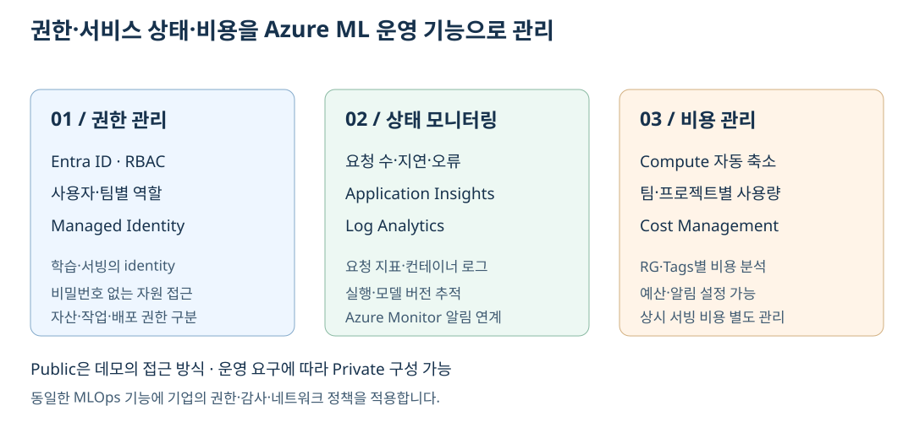

[SVG 원본 크게 보기](docs/images/operating-boundaries.svg)

MLOps에서는 모델 품질 외에도 접근 권한, 서비스 상태와 지속 비용을 관리해야 합니다.
이번 구성은 public 진입점을 사용하되 인증과 Storage 정책을 충족하는 경계를 둡니다.

* Storage는 `SecuredByPerimeter` 및 NSP Enforced 규칙으로 보호합니다.
  운영 PC의 직접 접근에는 Entra 권한과 허용된 공인 egress IP가 필요합니다.
  네트워크·VPN 변경 시 IP와 Storage 접근을 다시 확인합니다.
* AML의 Storage/Key Vault 접근은 Managed Network의 Private Endpoint를 사용합니다.
  `AllowInternetOutbound` 설정이므로 완전한 인터넷 차단 환경은 아닙니다.
* ACR은 인증된 public 이미지 경로를 사용하며 Private Endpoint는 없습니다.
  ACR admin과 anonymous pull은 비활성화했습니다.
* Endpoint 지표, Application Insights와 Log Analytics로 호출 흔적을 확인했습니다.
  무인증 401은 컨테이너 이전에 거부되므로 Application Insights에 기록되지 않습니다.
  지표 수집 지연이 있으며, 경보·SLO나 모델 품질·드리프트 감지 검증과는 다릅니다.
* 학습 클러스터는 최소 0대로 축소되지만 CPU 서빙 1대는 요청이 없어도 과금됩니다.
  ACR Premium, Storage, Private Endpoint와 로그 비용도 별도입니다.

확인 위치: Studio의 Compute·Endpoints와 Azure Portal의
Storage Networking·NSP·ACR·Application Insights·Log Analytics를 연결해 살펴봅니다.
팀 RG·Workspace와 실행 identity 범위의 격리는 별도 다중 팀 데모에서 다룹니다.
실제 10개 팀의 사용자·Entra 그룹 권한, GPU·Slurm/Lustre, 운영 HA는 검증 범위가 아닙니다.

## 11. CI와 실행 Workflow: 검증 자동화와 모델 운영 자동화 구분하기

<a id="실행-workflow"></a>

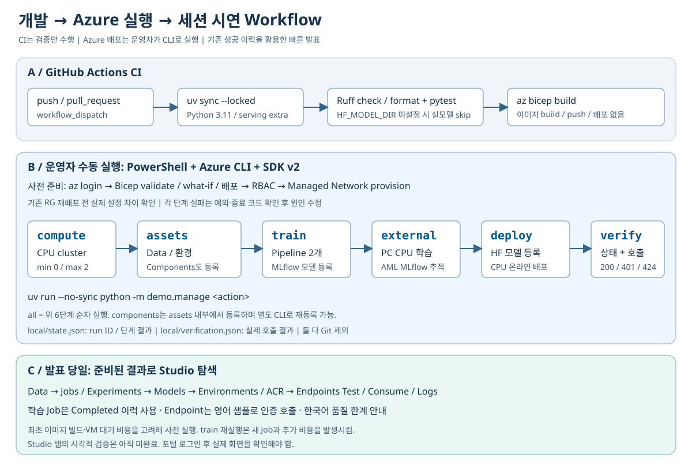

[Workflow SVG 원본 크게 보기](docs/images/demo-workflow.svg)

GitHub Actions는 코드의 Ruff·pytest와 Bicep build를 검증합니다.
별도 Pages workflow는 이 문서 사이트를 빌드·게시합니다.
클라우드 학습·이미지 빌드·모델 배포를 자동 실행하는 CD는 아닙니다.
현재 Azure 실행은 운영자가 수행하고, AML이 환경 이미지를 빌드해 ACR에 저장합니다.
운영 전환 시 품질 기준·승인·승격/롤백·재학습 trigger를 추가 설계해야 합니다.

SDK/API와 Endpoint 호출 검증은 완료 이력이 있지만,
로그인 후 Studio 탭별 시각적 검증은 남아 있습니다.
AutoML, Designer의 시각적 편집, Responsible AI, Batch Endpoint와 Drift monitor는 이번 범위 밖입니다.

1~11번의 SVG는 외부 이미지·폰트·스크립트 없이 표시됩니다.
작은 화면에서는 각 그림 아래의 SVG 원본 링크를 열어 확대하세요.

## 12. 재실행·개발 참고

리소스 재구성·코드 실행·종료가 필요한 경우에만 아래 참고 영역을 펼칩니다.
명령은 읽기 전용이 아니며 학습·추론·배포 비용 또는 리소스 삭제를 발생시킬 수 있습니다.

<details>
<summary>실행 명령과 개발·비용·종료 참고 펼치기</summary>

### 시작하기

필수 도구: Python 3.11, [uv](https://docs.astral.sh/uv/), Azure CLI, Bicep,
리소스 생성·역할 부여 권한이 있는 Azure 계정.
아래 명령은 저장소 루트의 PowerShell에서 실행합니다.

```powershell
az login
az account set --subscription "<your-subscription-id>"
uv sync --locked --extra serving --python 3.11
uv run --no-sync pytest -q

az group create --name rg-kt-mlops --location koreacentral
$operatorId = az ad signed-in-user show --query id -o tsv
az bicep build --file infra\main.bicep
$operatorPrefix = "<your-public-egress-ipv4>/32"
az deployment group validate --resource-group rg-kt-mlops `
  --template-file infra\main.bicep `
  --parameters operatorPrincipalId=$operatorId operatorAddressPrefix=$operatorPrefix
az deployment group what-if --resource-group rg-kt-mlops `
  --template-file infra\main.bicep `
  --parameters operatorPrincipalId=$operatorId operatorAddressPrefix=$operatorPrefix
az deployment group create --name kt-mlops-foundation `
  --resource-group rg-kt-mlops --template-file infra\main.bicep `
  --parameters operatorPrincipalId=$operatorId operatorAddressPrefix=$operatorPrefix

New-Item -ItemType Directory -Force local | Out-Null
az deployment group show --resource-group rg-kt-mlops `
  --name kt-mlops-foundation --query properties.outputs.config.value -o json |
  Set-Content -Encoding utf8 local\config.json
$workspaceId = az resource show --resource-group rg-kt-mlops `
  --name mlw-ktmlops-secure --resource-type Microsoft.MachineLearningServices/workspaces `
  --query identity.principalId -o tsv
$scope = "/subscriptions/$(az account show --query id -o tsv)/resourceGroups/rg-kt-mlops"
az role assignment create --assignee-object-id $workspaceId `
  --assignee-principal-type ServicePrincipal `
  --role "Azure AI Enterprise Network Connection Approver" --scope $scope
uv run --no-sync python -c "from demo.workspace import client,ROOT; m=client(ROOT/'local'/'config.json'); m.workspaces.begin_provision_network(workspace_name=m.workspace_name).result()"
uv run --no-sync python -m demo.manage all
```

Azure RBAC 변경은 전파에 수 분 걸릴 수 있습니다. 실패한 단계는 원인을 확인한 뒤
개별적으로 다시 실행합니다. 모든 실패는 예외와 종료 코드로 노출합니다.
완료된 단계와 run ID는 Git에서 제외된 `local/state.json`에,
실시간 검증 결과는 `local/verification.json`에 남습니다.

```powershell
uv run --no-sync python -m demo.manage compute
uv run --no-sync python -m demo.manage assets
uv run --no-sync python -m demo.manage components
uv run --no-sync python -m demo.manage train
uv run --no-sync python -m demo.manage external
uv run --no-sync python -m demo.manage deploy
uv run --no-sync python -m demo.manage verify
```

첫 실행은 이미지 빌드와 VM 할당 때문에 오래 걸릴 수 있습니다.
같은 이름/버전의 자산은 덮어쓰는 용도가 아닙니다. 코드·환경·데이터를 변경했다면
새 버전으로 등록하세요. `train` 재실행은 새 Job을 제출하므로 추가 비용이 발생합니다.

### 팀 RG와 Registry 재현

[Registry 템플릿](infra/shared-registry.bicep)을 공통 RG에 먼저 배포한 뒤,
[팀 템플릿](infra/teams.bicep)을 구독 범위에 배포합니다.
`operatorPrincipalId`, `operatorAddressPrefix`, `registryStorageId`가 필요합니다.
마지막 값은 Registry ARM 속성의
`regionDetails[0].storageAccountDetails[0].systemCreatedStorageAccount.armResourceId.resourceId`에서 확인합니다.
배포 전 Bicep build, ARM validate와 what-if를 수행합니다.

새 팀 Workspace는 처음 생성할 때 Managed Network mode가 Disabled여야 합니다.
기존 AllowInternetOutbound Workspace를 템플릿 재배포만으로 Disabled로 바꿀 수 없습니다.
아래 명령은 Workspace를 자동 삭제하지 않으며, 설정이 다르면 명시적으로 실패합니다.
기존 검증 `mlw-ktmlops-secure`의 네트워크는 그대로 유지합니다.

```powershell
$subscription = az account show --query id -o tsv
uv run --no-sync python -m demo.multiteam publish --subscription $subscription
uv run --no-sync python -m demo.multiteam prepare --subscription $subscription
uv run --no-sync python -m demo.multiteam consume --subscription $subscription
uv run --no-sync python -m demo.multiteam costs --subscription $subscription
```

`prepare`는 전용 subnet에서 public IP 없는 CPU cluster를 만들고,
팀 Storage marker와 identity 권한을 준비합니다.
`consume`은 실제 공유 모델 추론과 1→2, 2→3, 3→1 Storage 접근 거부를 검사합니다.
모든 여섯 방향의 조합이나 실제 팀 사용자 계정을 검사하는 것은 아닙니다.
실행 증적과 공유 완료 단계는 Git 제외 대상인 `local/multiteam.json`에 남습니다.
각 완료 Job의 자식 실행 로그를 내려받아 검증한 보고서는
`local/<workspace>/<job>/verification.json`에 저장합니다.
공유 완료 후 재실행할 때도 이 상태 파일을 보존합니다.
팀 Compute가 0대로 줄어도 NAT·Private Endpoint·ACR 등의 기본 비용은 계속 발생합니다.

### 가벼운 학습 시나리오

1,500행의 합성 데이터에서 동일한 1,125행 train / 375행 holdout을 사용합니다.
CPU Logistic Regression과 깊이 6, 100개 트리의 작은 Random Forest를 비교합니다.
LLM continual fine-tuning은 실행하지 않습니다. 짧은 학습으로 Data → Prepare →
Train → MLflow package → Model registration을 구성하고, 별도 HF 모델로 CPU 서빙을 수행합니다.
HF MiniLM은 학습한 churn 모델이 아니며 두 모델의 lineage를 혼동하지 않습니다.

학습 자체와 달리 최초 Conda 이미지 빌드, 네트워크 및 VM provisioning은
수 분 이상 걸릴 수 있습니다.

### ACR Custom 이미지 빌드

[학습 환경](environments/training.yml)과 [서빙 환경](environments/serving.yml)의
Conda/pip 의존성을 MCR 기본 이미지 위에 설치하도록 AML이 Dockerfile을 생성합니다.
`cpu-secure`에서 이미지 빌드를 수행하고 연결된 ACR
`crktmlopsaow7cshia2xmu.azurecr.io`에 push합니다.
학습 Job과 온라인 배포는 인증된 ACR public 경로로 각 환경의 이미지를 pull합니다.
기본 이미지만 참조한 것이 아니라 실제 의존성이 설치된 Custom 이미지가 저장되어 있습니다.

현재 학습은 `kt-sklearn-mlflow:2`, HF 서빙은 `kt-hf-cpu:1`을 사용합니다.
두 이미지의 Completed 빌드 Job과 불변 digest는
[실제 배포 상태](docs/deployment-status.md#acr-custom-이미지-빌드-검증)에 기록했습니다.
수동 Dockerfile이나 `az acr build`를 이용한 ACR Tasks 빌드가 아니라
AML이 관리하는 환경 이미지 빌드입니다. GitHub CI는 테스트·Bicep 검증을 수행하며
이미지 빌드·push를 자동 실행하지 않습니다.

### 전체 MLOps 완료 범위

기존 실행 이력, 현재 자산 조회, 실제 Endpoint 호출로 다음 두 경로를 확인했습니다.
이번 검토에서는 학습·이미지 빌드·배포·테스트를 다시 실행하지 않았습니다.

* 학습 경로: Data v1/v2 등록 -> Prepare/Train Pipeline -> MLflow 추적·패키징 ->
  Job 완료 후 SDK로 churn 모델 v1/v2 등록
* 서빙 경로: 사전학습 HF MiniLM 고정 revision -> 별도 custom model 등록 ->
  ACR 환경 이미지 -> CPU Endpoint 배포 -> 인증·추론 호출 검증

`all`은 CLI에서 각 단계를 순서대로 호출하는 편의 명령입니다.
AML Pipeline graph 자체는 Prepare -> Train이며,
등록한 churn 모델의 배포 단계까지 연결된 단일 그래프가 아닙니다.
자동 최적 모델 선택·품질 기준 승인·승격/롤백·드리프트 기반 재학습·클라우드 CD는
구현하지 않았습니다. Studio 로그인 후 탭별 시각적 검증도 남아 있습니다.
[완료 판정과 한계](docs/deployment-status.md#전체-mlops-파이프라인-검토-결론)를 확인하세요.

### 패키지 다운로드 환경

작업 PC에서 PyPI 파일 호스트 TLS 연결이 실패하여 public PyPI mirror를 사용했습니다.
TLS 인증서 검증은 유지합니다. PyTorch는 공식 CPU wheel index만 사용합니다.
`uv.lock`은 버전과 해시를 고정합니다.
일반 네트워크에서 공식 PyPI를 쓰려면 `pyproject.toml`의 `pypi-mirror` index를 제거하고
`uv lock`을 다시 실행한 뒤 변경된 lockfile을 검토하세요.
클라우드 환경의 pip 설치는 공식 PyPI와 공식 PyTorch CPU index를 사용합니다.

### 기능·SDK 기준

* Azure ML SDK v2의 `azure-ai-ml`, `Input/Output`, `command`, `dsl.pipeline` 사용
* 데이터는 v1 Dataset API 대신 v2 Data asset 및 MLTable 사용
* ACI/AKS v1 배포 대신 Managed Online Endpoint 사용
* 호환성 기준으로 MLflow 2.22.2 고정, MLflow 3 전용 API는 사용하지 않음
* MLflow registry stage에 의존하지 않고 명시적인 AML 모델 버전 사용
* HF commit SHA 고정, safetensors 사용, remote code 실행 금지
* 추론 시 HF 네트워크 접근 없이 Workspace에 등록한 모델 사용

최신 기능은 리전·구독·포털 업데이트에 따라 달라집니다.
모든 Azure ML 기능을 구성하는 예제는 아닙니다.
AutoML, Designer의 시각적 편집, Responsible AI, Drift monitor, Batch Endpoint는
이번 Agenda 밖이며 빈 화면을 채우기 위해 가짜 자산을 만들지 않습니다.

### 비용과 종료

2026-10-26 Retail Prices API에서 Korea Central Linux DS2_v2는
US$0.165/시간으로 확인했습니다. 24시간 약 US$3.96이며 ACR Basic,
Storage와 로그 비용은 별도입니다. 현재 구성은 ACR Premium, Private Endpoint,
Managed Network를 추가 사용하므로 이전 Basic 기준 일일 비용 추정은 적용하지 않습니다.
사용량·요율·세금·환율에 따라 달라집니다.

* 학습 DS3_v2 클러스터: min=0, max=2, 유휴 120초 후 축소
* 실시간 서빙 DS2_v2 1대: 요청이 없어도 계속 과금
* Log Analytics: 30일 보존, 일일 1GB soft cap (강제 예산 한도 아님)
* GPU 및 상시 Compute Instance 없음

서빙 비용만 중지하려면 인증된 Azure ML Studio에서 `kt-hf-cpu-secure` endpoint를 삭제하세요.
코드·데이터·모델·Job 이력은 Workspace에 남습니다. 필요 시 `deploy` 단계로 재생성합니다.
전체 삭제는 아래 명령의 대상 RG를 확인하고 명시적으로 실행합니다.

```powershell
# 이 RG의 데모 자산과 실행 이력을 모두 삭제합니다.
az group delete --name rg-kt-mlops --yes --no-wait
```

Key Vault purge protection 때문에 삭제 후에도 보존 기간 동안 이름 재사용이 제한됩니다.
이 저장소의 자동 실행은 리소스를 삭제하지 않습니다.

</details>

## 13. 상세 문서

* [현재 기능에 대한 공식 근거](docs/research.md)
* [실행 검증 결과와 전체 MLOps 완료 범위](docs/deployment-status.md)
