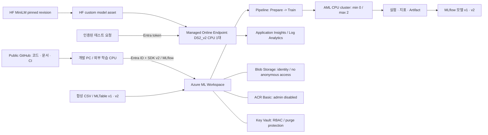

## 무엇을 시연하나요

> [!WARNING]
> 2026-10-26 실제 배포는 기본 인프라와 CPU 클러스터까지 완료했습니다.
> 상위 Azure Policy가 Storage의 public 접근을 강제로 차단하여
> 클라우드 Data/Model 등록, 학습 Job, Endpoint 생성·검증은 완료하지 못했습니다.
> 아래 표는 구현된 시나리오의 목표이며 현재 포털에 모든 자산이 있다는 뜻이 아닙니다.
> [실제 배포 상태와 차단 해소 절차](docs/deployment-status.md)를 먼저 확인하세요.

Azure Machine Learning Studio에서 데이터 버전, 실험 비교, MLflow 모델 패키지,
파이프라인 실행 이력, 실시간 CPU 서빙을 연결해서 확인하는 교육용 저장소입니다.
실제 고객 데이터, 고객 내부 설계 원문, 발표 자료, 자격 증명은 포함하지 않습니다.

| 교육 Agenda | 실행 결과 | Studio 메뉴 |
|---|---|---|
| MLOps Overview, DevOps와 차이 | 코드 + 데이터 + 환경 + 모델의 버전 연결 | [진행 가이드](docs/session-guide.md) |
| 데이터 등록·관리 | `telco-churn` 및 `telco-churn-table`, 각 v1/v2 | Data |
| MLflow 실험 추적 | 동일 holdout의 Logistic / Random Forest 비교 | Jobs, Experiments |
| 모델 패키징·등록 | Signature, input example, metrics, confusion matrix | Models, Jobs의 Outputs + logs |
| AML 파이프라인 | 데이터 준비 -> 학습 -> 모델 출력 | Jobs의 pipeline graph, Components |
| 외부 학습 연계 | 로컬 CPU 학습을 AML MLflow에 기록 | Jobs의 `kt-external-mlflow` |
| HF 소형 CPU 모델 서빙 | 상담 문장 3개 intent 분류 | Models, Endpoints의 Test/Consume/Logs |

> [!IMPORTANT]
> `all-MiniLM-L6-v2`는 약 22.7M 파라미터의 영어 임베딩 모델입니다.
> 생성형 LLM이나 한국어 품질 검증 모델이 아닙니다.
> 영어 합성 상담 문장을 임베딩하고 프로토타입과 cosine similarity를 비교합니다.
> similarity는 보정된 확률이 아니며 실제 고객 업무 판단에 사용하지 않습니다.

## 아키텍처



기본 리전은 Korea Central입니다. 이 예제는 단일 Workspace, public network,
Entra 인증을 사용하는 교육 환경입니다.
Private Link, GPU, Slurm/Lustre, 과제별 다중 Workspace 격리와 운영 HA는 배포하지 않습니다.
외부 추적은 Slurm과 같은 위치 독립적인 MLflow 패턴을 PC에서 재현하며,
실제 Slurm 통합 검증을 대신하지 않습니다.

## 시작하기

필수 도구: Python 3.11, [uv](https://docs.astral.sh/uv/), Azure CLI, Bicep,
리소스 생성·역할 부여 권한이 있는 Azure 계정.
아래 명령은 저장소 루트의 PowerShell에서 실행합니다.

```powershell
az login
az account set --subscription "<your-subscription-id>"
uv sync --locked --extra serving --python 3.11
uv run --no-sync pytest -q

az group create --name rg-kt-mlops --location koreacentral
$operatorId = az ad signed-in-user show --query id -o tsv
az bicep build --file infra\main.bicep
az deployment group validate --resource-group rg-kt-mlops `
  --template-file infra\main.bicep --parameters operatorPrincipalId=$operatorId
az deployment group what-if --resource-group rg-kt-mlops `
  --template-file infra\main.bicep --parameters operatorPrincipalId=$operatorId
az deployment group create --name kt-mlops-foundation `
  --resource-group rg-kt-mlops --template-file infra\main.bicep `
  --parameters operatorPrincipalId=$operatorId

New-Item -ItemType Directory -Force local | Out-Null
az deployment group show --resource-group rg-kt-mlops `
  --name kt-mlops-foundation --query properties.outputs.config.value -o json |
  Set-Content -Encoding utf8 local\config.json
uv run --no-sync python -m demo.manage all
```

Azure RBAC 변경은 전파에 수 분 걸릴 수 있습니다. 실패한 단계는 원인을 확인한 뒤
개별적으로 다시 실행합니다. 모든 실패는 예외와 종료 코드로 노출합니다.
완료된 단계와 run ID는 Git에서 제외된 `local/state.json`에,
실시간 검증 결과는 `local/verification.json`에 남습니다.

```powershell
uv run --no-sync python -m demo.manage compute
uv run --no-sync python -m demo.manage assets
uv run --no-sync python -m demo.manage train
uv run --no-sync python -m demo.manage external
uv run --no-sync python -m demo.manage deploy
uv run --no-sync python -m demo.manage verify
```

첫 실행은 이미지 빌드와 VM 할당 때문에 오래 걸립니다. 세션 전날 미리 실행하세요.
같은 이름/버전의 자산은 덮어쓰는 용도가 아닙니다. 코드·환경·데이터를 변경했다면
새 버전으로 등록하세요. `train` 재실행은 새 Job을 제출하므로 추가 비용이 발생합니다.

### 패키지 다운로드 환경

작업 PC에서 PyPI 파일 호스트 TLS 연결이 실패하여 public PyPI mirror를 사용했습니다.
TLS 인증서 검증은 유지합니다. PyTorch는 공식 CPU wheel index만 사용합니다.
`uv.lock`은 버전과 해시를 고정합니다.
일반 네트워크에서 공식 PyPI를 쓰려면 `pyproject.toml`의 `pypi-mirror` index를 제거하고
`uv lock`을 다시 실행한 뒤 변경된 lockfile을 검토하세요.
클라우드 환경의 pip 설치는 공식 PyPI와 공식 PyTorch CPU index를 사용합니다.

## 기능·SDK 기준

* Azure ML SDK v2의 `azure-ai-ml`, `Input/Output`, `command`, `dsl.pipeline` 사용
* 데이터는 v1 Dataset API 대신 v2 Data asset 및 MLTable 사용
* ACI/AKS v1 배포 대신 Managed Online Endpoint 사용
* 호환성 기준으로 MLflow 2.22.2 고정, MLflow 3 전용 API는 사용하지 않음
* MLflow registry stage에 의존하지 않고 명시적인 AML 모델 버전 사용
* HF commit SHA 고정, safetensors 사용, remote code 실행 금지
* 추론 시 HF 네트워크 접근 없이 Workspace에 등록한 모델 사용

최신 기능은 리전·구독·포털 업데이트에 따라 달라집니다.
모든 Azure ML 기능을 구성하는 예제는 아닙니다.
AutoML, Designer의 시각적 편집, Responsible AI, Drift monitor, Batch Endpoint는
이번 Agenda 밖이며 빈 화면을 채우기 위해 가짜 자산을 만들지 않습니다.

## 비용과 종료

2026-10-26 Retail Prices API에서 Korea Central Linux DS2_v2는
US$0.165/시간으로 확인했습니다. 24시간 약 US$3.96이며 ACR Basic,
Storage와 로그 비용은 별도입니다. 전체 계획치는 하루 약 US$5~7이지만
사용량·요율·세금·환율에 따라 달라집니다.

* 학습 DS3_v2 클러스터: min=0, max=2, 유휴 120초 후 축소
* 실시간 서빙 DS2_v2 1대: 요청이 없어도 계속 과금
* Log Analytics: 30일 보존, 일일 1GB soft cap (강제 예산 한도 아님)
* GPU 및 상시 Compute Instance 없음

서빙 비용만 중지하려면 인증된 Azure ML Studio에서 `kt-hf-cpu` endpoint를 삭제하세요.
코드·데이터·모델·Job 이력은 Workspace에 남습니다. 필요 시 `deploy` 단계로 재생성합니다.
전체 삭제는 아래 명령의 대상 RG를 확인하고 명시적으로 실행합니다.

```powershell
# 이 RG의 데모 자산과 실행 이력을 모두 삭제합니다.
az group delete --name rg-kt-mlops --yes --no-wait
```

Key Vault purge protection 때문에 삭제 후에도 보존 기간 동안 이름 재사용이 제한됩니다.
이 저장소의 자동 실행은 리소스를 삭제하지 않습니다.

## 문서

* [교육 진행 가이드와 Studio 탭 순서](docs/session-guide.md)
* [현재 기능에 대한 공식 근거](docs/research.md)
* [실행 검증 결과](docs/validation.md)
